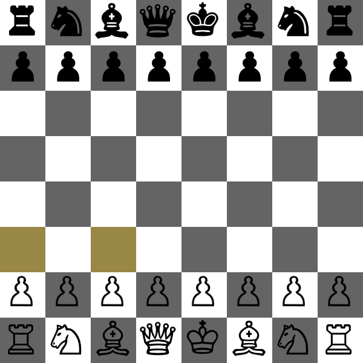

# Chess Game

**A from-scratch chess engine with a drag-and-drop Swing board — legal move generation, check/checkmate detection, and an evaluation-driven AI opponent, all hand-rolled in Java with no chess libraries.**

<p align="center"></p>

A desktop chess game built on a hand-written rules engine. Every piece's movement, check and checkmate detection, and the computer opponent are implemented directly against an 8×8 board — no external chess logic.

## Features
- All six piece types with correct move rules, including path blocking so rooks, bishops, and queens can't jump over pieces
- Check and checkmate detection — the engine rejects any move that would leave your own king in check
- Optional AI opponent (plays Black) that scores moves with piece values plus piece-square tables, adapted from the Chess Programming Wiki's simplified evaluation
- Drag-and-drop pieces, with every legal destination highlighted for the piece you pick up
- Save and load games to a file, undo moves, and start a new game
- Pawn two-square opening move and automatic promotion to a queen on the back rank

## Run it
```bash
cd ChessGame
javac -d bin $(find src -name '*.java')
java -cp bin:res main.MainGame     # res/ holds the piece sprites
```
Java 8+. Tick the **AI** checkbox to have the computer take Black.

## How it works
The board is an 8×8 array of pieces, and each `PieceType` carries a lambda encoding its movement rule, sharing one directional path-scan so sliding pieces stop at the first blocker. Check detection copies the board, plays the candidate move, then asks whether any enemy piece can now reach the king; checkmate is simply the absence of any legal move that escapes check. The AI enumerates Black's legal moves and picks the one that maximizes a material + piece-square-table evaluation.

Tech: Java 8 · Swing/AWT · JUnit 4 tests (piece rules, checkmate, save/load).
